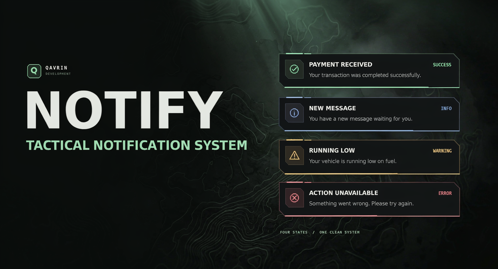

# QAVRIN Notify

A lightweight, framework-independent notification system for FiveM. It is built for **Qbox**, works on **ESX**, and runs perfectly on **standalone** servers without any framework dependency.



## Contents

- [Features](#features)
- [Requirements](#requirements)
- [Installation](#installation)
- [Configuration](#configuration)
- [USAGE](#usage)
- [Notification fields](#notification-fields)
- [Client event](#client-event)
- [Server-triggered notifications](#server-triggered-notifications)
- [Qbox usage](#qbox-usage)
- [ESX usage](#esx-usage)
- [Standalone usage](#standalone-usage)
- [Commands](#commands)
- [Appearance and behavior](#appearance-and-behavior)
- [Common recipes](#common-recipes)
- [Behavior rules](#behavior-rules)
- [Migrating from QBCore](#migrating-from-qbcore)
- [Troubleshooting](#troubleshooting)
- [Project structure](#project-structure)
- [License](#license)

## Features

- Works on Qbox, ESX, and standalone servers
- Qbox-first framework detection through `qbx_core`
- ESX detection through `es_extended`
- No hard dependency on Qbox, ESX, ox_lib, or any other resource
- Four notification types: `success`, `info`, `warning`, and `error`
- Custom title, message, and duration
- Configurable screen position and maximum visible notifications
- Client exports, local client events, and server-triggered notifications
- Notification queue while the NUI is loading, so early notifications are not lost
- Built-in test and diagnostics commands
- GitHub release version checker that reports updates in the server console
- Local fonts and a transparent NUI overlay
- Clean, comment-free Lua and JavaScript source

## Requirements

- A working FiveM server
- FiveM NUI support, which is built in
- No framework dependency
- Qbox or ESX are optional; they are only detected and reported

## Installation

### Common installation

1. Download or clone this repository.
2. Place the `qavrin-notify` folder inside your server's `resources` directory.
3. Add the correct `ensure` lines for your framework to `server.cfg`.
4. Restart the server, or run `refresh` and then `ensure qavrin-notify` in the server console.
5. Join the server and run `/qnotify`.

The resource folder must be named `qavrin-notify` so the export examples work as written. If you rename the folder, replace `qavrin-notify` in every export call with the new folder name.

### Qbox installation

Start `qbx_core` before `qavrin-notify`:

```cfg
ensure qbx_core
ensure qavrin-notify
```

With the default `Config.Framework = 'auto'`, the resource detects `qbx_core` and reports `qbox`. You can also force it:

```lua
Config.Framework = 'qbox'
```

No Qbox API or Qbox dependency is required. The exports and events work exactly the same way.

### ESX installation

Start `es_extended` before `qavrin-notify`:

```cfg
ensure es_extended
ensure qavrin-notify
```

With the default `Config.Framework = 'auto'`, the resource detects `es_extended` and reports `esx`. You can also force it:

```lua
Config.Framework = 'esx'
```

No ESX API or ESX dependency is required. The exports and events work exactly the same way.

### Standalone installation

Standalone servers only need this line:

```cfg
ensure qavrin-notify
```

With the default `Config.Framework = 'auto'`, the resource falls back to `standalone` when no supported framework is running. You can also force it:

```lua
Config.Framework = 'standalone'
```

### Installation check

After starting the resource, run this in game:

```text
/qnotify
```

You should see a green success notification. Run:

```text
/qnotifyhelp
```

It shows the detected framework. The client prints the detected framework and installed version in the player's F8 console. The server console separately reports the GitHub version-check result.

## Configuration

Edit `config.lua`:

```lua
Config = {}

Config.Framework = 'auto'
Config.EnableVersionCheck = true
Config.DefaultDuration = 5000
Config.MaxDuration = 15000
Config.Position = 'top-right'
Config.MaxVisible = 5

Config.Commands = {
    enabled = true,
    test = 'qnotify',
    help = 'qnotifyhelp'
}

Config.Types = {
    success = { label = 'SUCCESS' },
    info = { label = 'INFO' },
    warning = { label = 'WARNING' },
    error = { label = 'ERROR' }
}
```

| Option | Default | Description |
| --- | --- | --- |
| `Config.Framework` | `auto` | `auto`, `standalone`, `qbox`, or `esx`. `auto` checks `qbx_core`, then `es_extended`, then falls back to standalone. |
| `Config.EnableVersionCheck` | `true` | Checks the latest published GitHub Release once when the resource starts. Set to `false` to disable it. |
| `Config.DefaultDuration` | `5000` | Default display time in milliseconds when no duration is supplied. |
| `Config.MaxDuration` | `15000` | Maximum display time in milliseconds. |
| `Config.Position` | `top-right` | `top-right`, `top-left`, `bottom-right`, or `bottom-left`. |
| `Config.MaxVisible` | `5` | Maximum number of notifications visible at once. |
| `Config.Commands.enabled` | `true` | Enables or disables the test and diagnostics commands. |
| `Config.Commands.test` | `qnotify` | Name of the test command. |
| `Config.Commands.help` | `qnotifyhelp` | Name of the diagnostics command. |
| `Config.Types` | four types | Notification types and their default uppercase labels. |

Framework detection is informational only. The notification API works on every supported setup, with or without Qbox or ESX.


## Version checker

QAVRIN Notify checks the latest **published GitHub Release** once when the resource starts and prints the result in the FiveM **server console**.

- If a newer release exists, it prints the installed version, latest version, and release download link.
- If the installed version is current, it prints an up-to-date message.
- If GitHub is unavailable, the notification resource continues working normally.
- The checker never downloads or overwrites files automatically. Server owners choose when to update.
- Only published GitHub Releases are checked. Creating a Git commit alone does not publish an update.

To disable the checker, set this in `config.lua`:

```lua
Config.EnableVersionCheck = false
```

### Publishing an update as the developer

1. Update the `version` value in `fxmanifest.lua` (for example, `1.0.0` to `1.0.1`).
2. Commit and push the updated source to GitHub.
3. Create a GitHub Release with a matching tag, such as `v1.0.1`.
4. Attach the updated ZIP package to the release.

The version checker reads the tag from the repository's latest published release. Use three-part numeric tags such as `v1.0.0`, `v1.0.1`, or `v1.1.0`.

The checker makes one unauthenticated GitHub API request at resource startup. GitHub may rate-limit repeated requests from the same public IP; if that happens, the update check is skipped and the resource continues working.

## USAGE

### Client export

Use the export from any client-side Lua script on Qbox, ESX, or standalone.

#### Table format

```lua
exports['qavrin-notify']:Notify({
    type = 'success',
    title = 'PAYMENT',
    description = 'You received $2,500.',
    duration = 5000
})
```

#### Positional format

```lua
exports['qavrin-notify']:Notify('success', 'You received $2,500.', 5000)
```

The positional signature is:

```lua
exports['qavrin-notify']:Notify(type, description, duration)
```

The default title for the positional format is the label from `Config.Types`, such as `SUCCESS`.

#### Export alias

Both names run the same function:

```lua
exports['qavrin-notify']:Notify({ ... })
exports['qavrin-notify']:ShowNotification({ ... })
```

## Notification fields

| Field | Type | Required | Description |
| --- | --- | --- | --- |
| `type` | string | No | `success`, `info`, `warning`, or `error`. Unknown values fall back to `info`. Defaults to `info`. |
| `title` | string | No | Header text. Defaults to the type label from `Config.Types`. |
| `description` | string | No | Main notification text. |
| `message` | string | No | Alias for `description`. `description` takes priority when both are supplied. |
| `duration` | number | No | Display time in milliseconds. Clamped between `1000` and `Config.MaxDuration`. Defaults to `Config.DefaultDuration`. |

Example using `message`:

```lua
exports['qavrin-notify']:Notify({
    type = 'warning',
    title = 'FUEL',
    message = 'Your vehicle is running low on fuel.',
    duration = 6000
})
```

## Client event

Use the local client event when the notification is triggered on the same client:

```lua
TriggerEvent('qavrin_notify:client:Notify', {
    type = 'info',
    title = 'QAVRIN',
    description = 'Welcome to the server!',
    duration = 5000
})
```

The positional format also works:

```lua
TriggerEvent('qavrin_notify:client:Notify', 'info', 'Welcome to the server!', 5000)
```

## Server-triggered notifications

### Notify one player

```lua
TriggerClientEvent('qavrin_notify:client:Notify', source, {
    type = 'success',
    title = 'DELIVERY',
    description = 'Your delivery has been completed.',
    duration = 5000
})
```

### Notify every player

```lua
TriggerClientEvent('qavrin_notify:client:Notify', -1, {
    type = 'warning',
    title = 'RESTART',
    description = 'The server will restart in 10 minutes.',
    duration = 10000
})
```

### Server command example

```lua
RegisterCommand('announce', function(source, args)
    local text = table.concat(args, ' ')

    if text == '' then
        TriggerClientEvent('qavrin_notify:client:Notify', source, {
            type = 'error',
            title = 'ANNOUNCE',
            description = 'Usage: /announce <message>',
            duration = 5000
        })
        return
    end

    TriggerClientEvent('qavrin_notify:client:Notify', -1, {
        type = 'info',
        title = 'ANNOUNCEMENT',
        description = text,
        duration = 8000
    })
end, false)
```

## Qbox usage

Qbox does not require a special API. Use the same exports and events from any Qbox resource.

### Qbox client example

```lua
local function showReward(amount)
    exports['qavrin-notify']:Notify({
        type = 'success',
        title = 'REWARD',
        description = ('You received $%s.'):format(amount),
        duration = 5000
    })
end
```

### Qbox server example

```lua
RegisterCommand('notifyme', function(source)
    TriggerClientEvent('qavrin_notify:client:Notify', source, {
        type = 'info',
        title = 'QBOX',
        description = ('Hello, %s.'):format(GetPlayerName(source)),
        duration = 5000
    })
end, false)
```

### Qbox detection

```lua
Config.Framework = 'auto'
```

The resource checks for `qbx_core` and reports `qbox`. This is informational only.

## ESX usage

ESX does not require a special API either. Use the same exports and events from any ESX resource.

### ESX client example

```lua
local function showPayment(amount)
    exports['qavrin-notify']:Notify({
        type = 'success',
        title = 'PAYMENT',
        description = ('You received $%s.'):format(amount),
        duration = 5000
    })
end
```

### ESX server example

```lua
RegisterCommand('esxnotify', function(source)
    TriggerClientEvent('qavrin_notify:client:Notify', source, {
        type = 'info',
        title = 'ESX',
        description = ('Hello, %s.'):format(GetPlayerName(source)),
        duration = 5000
    })
end, false)
```

### Replacing old ESX notifications

If a script currently uses `ESX.ShowNotification`, replace that call with the export:

```lua
exports['qavrin-notify']:Notify({
    type = 'info',
    title = 'ESX',
    description = 'Your changes have been saved.'
})
```

### ESX detection

```lua
Config.Framework = 'auto'
```

The resource checks for `es_extended` and reports `esx`. This is informational only.

## Standalone usage

Standalone servers do not need any framework. The export and event API are the same.

### Standalone client example

```lua
exports['qavrin-notify']:Notify({
    type = 'info',
    title = 'SERVER',
    description = 'Welcome to the server!',
    duration = 5000
})
```

### Standalone server example

```lua
TriggerClientEvent('qavrin_notify:client:Notify', -1, {
    type = 'warning',
    title = 'SERVER',
    description = 'A restart is scheduled soon.',
    duration = 8000
})
```

### Standalone detection

```lua
Config.Framework = 'auto'
```

When no supported framework is running, the reported framework is `standalone`. You can also set it manually:

```lua
Config.Framework = 'standalone'
```

## Commands

| Command | Default name | Purpose |
| --- | --- | --- |
| Test | `/qnotify` | Shows a success notification. |
| Diagnostics | `/qnotifyhelp` | Shows the detected framework. |

Rename or disable them in `config.lua`:

```lua
Config.Commands = {
    enabled = false,
    test = 'qnotify',
    help = 'qnotifyhelp'
}
```

Both commands are client commands and are available to every player while enabled. Disable them in production if you do not want players using them.

## Appearance and behavior

### Position

Set the screen corner:

```lua
Config.Position = 'top-right'
```

Allowed values:

- `top-right`
- `top-left`
- `bottom-right`
- `bottom-left`

### Maximum visible notifications

```lua
Config.MaxVisible = 5
```

When a new notification exceeds the limit, the oldest visible notification is removed.

### Default and maximum duration

```lua
Config.DefaultDuration = 5000
Config.MaxDuration = 15000
```

Durations are clamped between `1000` milliseconds and `Config.MaxDuration`.

### Type labels

```lua
Config.Types = {
    success = { label = 'SUCCESS' },
    info = { label = 'INFO' },
    warning = { label = 'WARNING' },
    error = { label = 'ERROR' }
}
```

## Common recipes

### Payment notification

```lua
exports['qavrin-notify']:Notify({
    type = 'success',
    title = 'PAYMENT',
    description = 'You received $1,200.',
    duration = 4000
})
```

### Error notification

```lua
exports['qavrin-notify']:Notify({
    type = 'error',
    title = 'ERROR',
    description = 'You do not have permission to do that.',
    duration = 5000
})
```

### Vehicle warning

```lua
exports['qavrin-notify']:Notify({
    type = 'warning',
    title = 'VEHICLE',
    description = 'Your engine is overheating.',
    duration = 6000
})
```

### Server restart warning

```lua
TriggerClientEvent('qavrin_notify:client:Notify', -1, {
    type = 'warning',
    title = 'RESTART',
    description = 'Server restart in 5 minutes.',
    duration = 10000
})
```

### Test all four types

```lua
for _, notificationType in ipairs({ 'success', 'info', 'warning', 'error' }) do
    exports['qavrin-notify']:Notify({
        type = notificationType,
        title = notificationType:upper(),
        description = 'Test notification.',
        duration = 5000
    })
end
```

## Behavior rules

- Unknown notification types fall back to `info`.
- Missing titles use the configured type label.
- Invalid durations use `Config.DefaultDuration`.
- Durations are clamped between `1000` milliseconds and `Config.MaxDuration`.
- Invalid positions fall back to `top-right`.
- Notifications sent before the NUI finishes loading are queued and shown when it is ready.
- The resource works without Qbox, ESX, or ox_lib.
- Framework detection does not change or limit the notification functionality.

## Migrating from QBCore

- Change `Config.Framework = 'qb'` to `Config.Framework = 'qbox'`, or leave it as `auto`.
- Framework detection now checks `qbx_core` instead of `qb-core`.
- The notification API is unchanged: `Notify`, `ShowNotification`, and `qavrin_notify:client:Notify` work exactly the same way.
- Start `qbx_core` before `qavrin-notify` so automatic detection can see it.
- Replace old QB-Core notification calls with the client export shown above.

## Troubleshooting

### Nothing appears

- Confirm the resource folder is named `qavrin-notify`.
- Check that `ensure qavrin-notify` is in `server.cfg`.
- Confirm the resource started without errors in the server console.
- Open the client F8 console and look for NUI or Lua errors.
- Make sure `html/index.html`, `html/style.css`, `html/app.js`, and the `html/fonts` folder are present.

### The notification appears but text or styling is missing

- Confirm all files listed in `fxmanifest.lua` were uploaded.
- Confirm `html/fonts/*.ttf` exists and has the correct case.
- Check the F8 console for NUI errors.
- Confirm the `html` folder was uploaded with all fonts and license files.

### Framework shows standalone on Qbox or ESX

- Make sure `qbx_core` or `es_extended` starts before `qavrin-notify`.
- Set `Config.Framework = 'qbox'` or `Config.Framework = 'esx'` to force the reported framework.
- Remember that this value is informational only and does not affect notifications.

### Duration is shorter or longer than expected

- Durations are clamped between `1000` milliseconds and `Config.MaxDuration`.
- `Config.DefaultDuration` is used when a notification has no valid duration.
- Unknown or invalid durations fall back to the configured default.

### Notifications do not appear for another player

- Use `TriggerClientEvent('qavrin_notify:client:Notify', targetId, data)`.
- Confirm the target player is loaded and connected.
- Use `-1` to send the notification to every player.

### `/qnotify` does nothing

- Confirm `ensure qavrin-notify` is in `server.cfg`.
- Check the server console for resource errors.
- Check the client F8 console for Lua or NUI errors.
- Confirm `Config.Commands.enabled` is set to `true`.

## Project structure

```text
qavrin-notify/
├── fxmanifest.lua
├── config.lua
├── client/
│   └── main.lua
├── server/
│   └── version_checker.lua
├── html/
│   ├── index.html
│   ├── style.css
│   ├── app.js
│   └── fonts/
│       ├── Barlow-Bold.ttf
│       ├── Manrope-Regular.ttf
│       ├── JetBrainsMono-Bold.ttf
│       └── OFL.txt
├── README.md
├── LICENSE
├── qavrin-notify-showcase.png
└── .gitignore
```

## License

This project is released under the MIT License. See [LICENSE](LICENSE).
